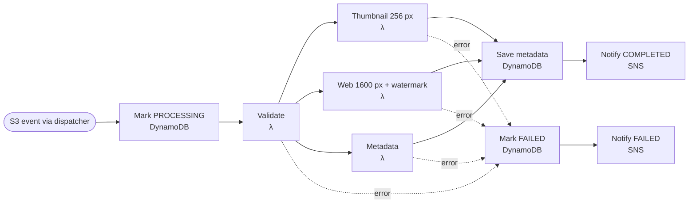

# Serverless Image Processing Pipeline

An event-driven, fully serverless image pipeline on AWS. Clients upload images straight to S3. Each upload is queued in SQS and processed by a Step Functions workflow: a Lambda function validates it, then three more create a thumbnail, a watermarked web copy and a metadata record, all in parallel. Processed images are served worldwide through CloudFront, and DynamoDB tracks each job's status. SNS sends an email when a job completes or fails.

> **Status:** the infrastructure (Terraform) is written and passes `terraform validate`. The Lambda handlers in `src/handlers/` are stubs that define each function's input and output. Nothing has been deployed yet.

---

## Architecture


The image never passes through API Gateway or SQS. It goes straight into S3 and comes out through CloudFront.

### Inside the Step Functions workflow

The "Image processing function" box in the diagram is a Step Functions Standard workflow:



Thumbnail, Web and Metadata run in parallel, and all three use the Pillow Lambda Layer. Each Lambda step retries temporary errors with exponential backoff before the error path takes over.

### How a request flows

1. **Request an upload.** The client calls `POST /uploads`. The `presign` Lambda creates an `imageId`, records it in DynamoDB as `PENDING`, and returns a pre-signed S3 POST form that only accepts images up to 10 MB.
2. **Upload to S3.** The client uploads the file directly to the private source bucket at `uploads/{imageId}/{filename}`.
3. **Queue the event.** S3 sends an `ObjectCreated` event to SQS. The `dispatcher` Lambda polls the queue and starts one Step Functions execution per image. Bursts wait in the queue instead of failing. A message that fails 3 times moves to the dead-letter queue, which triggers an alarm.
4. **Process.** The workflow validates the file by its actual contents (not its extension), then runs three branches in parallel:
   - a 256 px thumbnail
   - a 1600 px web copy with a watermark
   - metadata extraction

   It writes the results to DynamoDB and publishes to SNS. Any error marks the job `FAILED` and sends a failure notification.
5. **Serve.** CloudFront reads the private destination bucket using Origin Access Control and caches each image at the edge. Output file names include the `imageId` and never change, so a 1-year cache is safe.
6. **Check status.** `GET /images/{imageId}` returns the job's status and, once it's done, the CloudFront URLs.

---

## AWS services used

| Service | Role in this project | Key configuration |
|---|---|---|
| **Amazon S3** (source) | Receives uploads | Private, TLS-only, SSE-S3, CORS for browser POST. Lifecycle: Standard-IA at 30 days, Glacier Instant Retrieval at 90, delete at 365, abort incomplete uploads after 7 days |
| **Amazon S3** (destination) | Stores processed images | Private, readable only by the CloudFront distribution. Intelligent-Tiering lifecycle |
| **Amazon SQS** + DLQ | Separates uploads from processing, and holds events for retry | Long polling, visibility timeout 180 s, `maxReceiveCount = 3`, DLQ kept for 14 days. Queue policy only accepts events from the source bucket |
| **AWS Lambda** | `presign`, `status`, `dispatcher`, `validate`, `thumbnail`, `watermark`, `metadata` | Python 3.13 on arm64, one least-privilege IAM role per function, X-Ray tracing, JSON logs. Partial batch failures reported to SQS |
| **Lambda Layers** | Package Pillow once and share it across the 4 image functions | Built from prebuilt `manylinux` aarch64 wheels by `layers/pillow/build.sh` |
| **AWS Step Functions** | Runs the multi-step workflow | Standard workflow: Validate → Parallel(3) → DynamoDB → SNS. Per-step retries with backoff, and a catch-all that leads to the failure path. Saving to DynamoDB and notifying SNS are direct service calls, with no Lambda |
| **Amazon API Gateway** | Upload and status API | HTTP API with `POST /uploads` and `GET /images/{imageId}`, plus throttling, CORS and access logs |
| **Amazon DynamoDB** | Image metadata and job status | On-demand capacity, partition key `imageId`, GSI `status-uploadedAt`, point-in-time recovery |
| **Amazon CloudFront** | Serves processed images worldwide at low latency | Origin Access Control, managed `CachingOptimized` and security-headers policies, HTTPS only, HTTP/2 and HTTP/3 |
| **Amazon SNS** | Notifies when a job completes or fails, and delivers alarm notifications | Email subscription |
| **Amazon CloudWatch** | Logs, traces and alarms | Alarms on DLQ depth, failed executions, Lambda errors and API 5xx errors. 14-day log retention |

**No VPC on purpose:** every service here is managed and reached through IAM-authenticated AWS endpoints. Putting the Lambdas in a VPC would need NAT gateways or interface endpoints, which would likely cost more than the rest of the stack combined. It would add no protection for this workload. You'd add a VPC only to reach private resources such as RDS, or to meet a compliance rule.

---

## Learning outcomes

| Outcome | Where it shows up in this project |
|---|---|
| **Design event-driven architectures with S3 event notifications and SQS** | An S3 `ObjectCreated` event goes to SQS, and a Lambda polls the queue. The queue policy only accepts events from the source bucket in this account, to prevent the confused deputy problem. |
| **Understand why SQS decoupling improves resilience and enables retries** | Bursts wait in the queue, and consumer concurrency is capped. A failed message reappears after the visibility timeout and moves to the DLQ after 3 tries. You can redrive it from the console once the fault is fixed. |
| **Use Lambda Layers to package large dependencies** | Pillow ships as one arm64 layer attached only to the image functions. That keeps the code zip small and builds it for Lambda's Linux and CPU, not your laptop's. |
| **Orchestrate multi-step serverless workflows with Step Functions** | Validate → Parallel(thumbnail, web + watermark, metadata) → save → notify. It shows retries with backoff, `Catch` routing, parallel branches, direct DynamoDB and SNS calls, and runs named by `imageId` so a duplicate event can't start a second run. |
| **Apply S3 lifecycle policies to transition or expire objects by storage class** | Originals go Standard → Standard-IA (30 days) → Glacier Instant Retrieval (90 days) → deleted (365 days). Processed images use Intelligent-Tiering. Incomplete multipart uploads are aborted after 7 days. |
| **Serve processed content through CloudFront with appropriate cache behaviors** | Origin Access Control keeps the bucket private. Output file names never change, so a long cache with `Cache-Control: immutable` is safe and needs no invalidations. Price class 100 keeps costs down. |

---

## Repository layout

```
.
├── Serverless image processing application.png   # architecture diagram
├── infra/
│   ├── bootstrap/               # Terraform state bucket (applied once per account)
│   ├── envs/dev/                # dev environment: wires the modules together
│   └── modules/                 # storage, queue, data, functions, workflow, api, cdn, notify, alarms
├── statemachine/
│   └── pipeline.asl.json.tftpl  # Step Functions definition (Terraform template)
├── src/handlers/                # Lambda handlers (stubs that define each input/output)
├── layers/pillow/               # Pillow layer build script + pinned version
└── Makefile                     # local checks and guarded deploy targets
```

## Cost notes

Since this is a serverless application, the stack costs close to nothing while at idle. Lambda, SQS, SNS, Step Functions and DynamoDB on-demand are billed per use. A Standard workflow costs about $0.025 per 1,000 state transitions, and one image takes about 10. The main ongoing costs are S3 storage, CloudWatch Logs and CloudFront data transfer.
